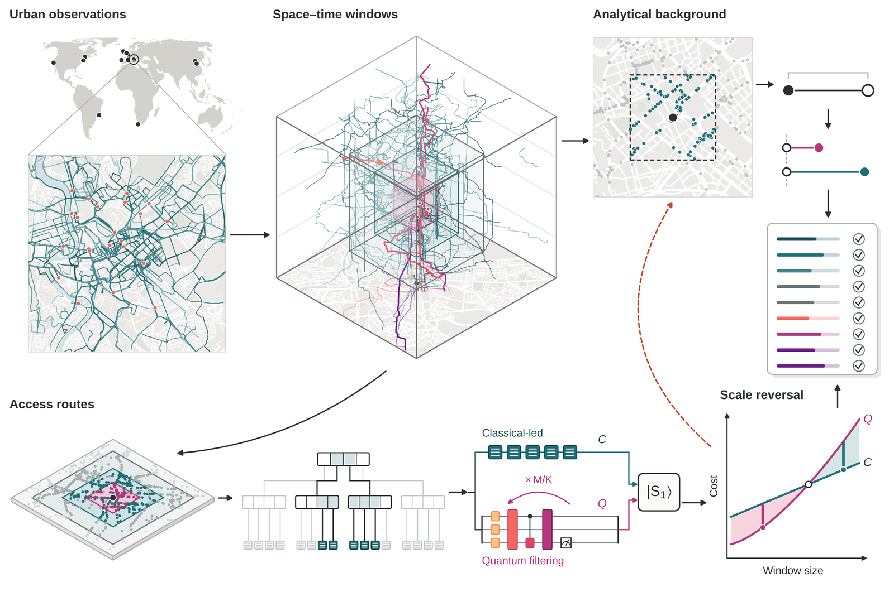
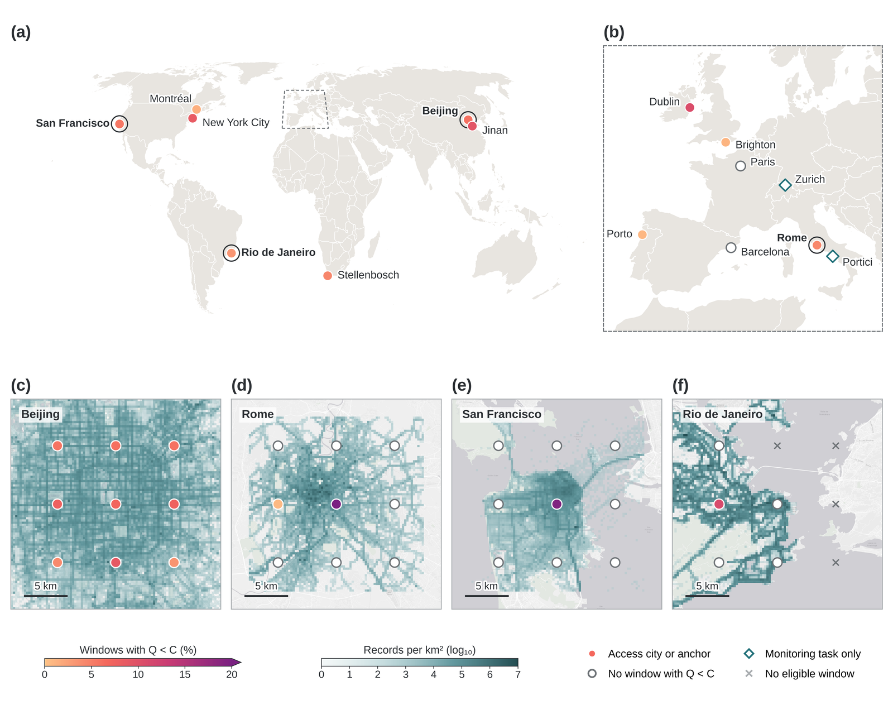
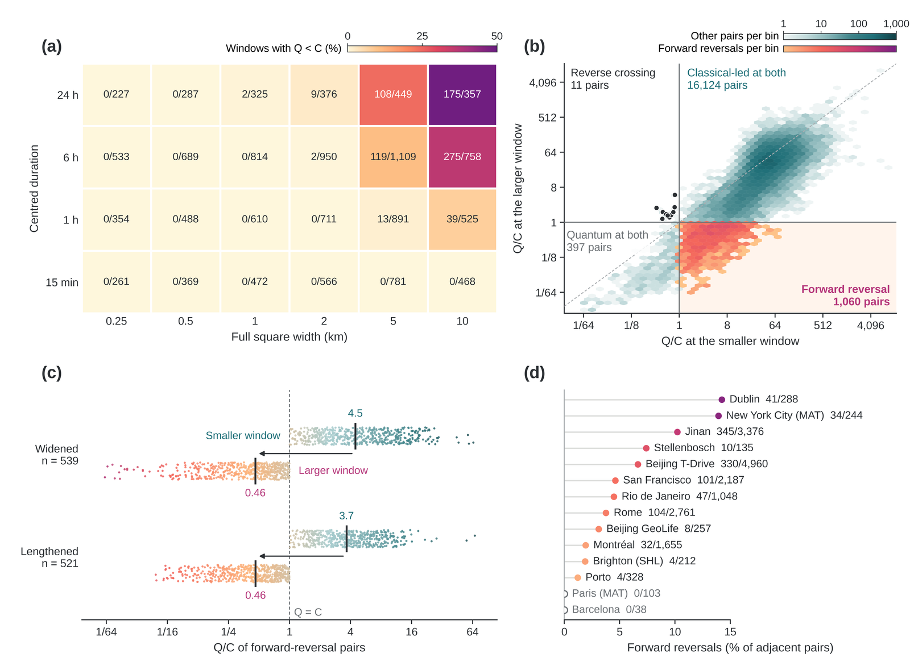
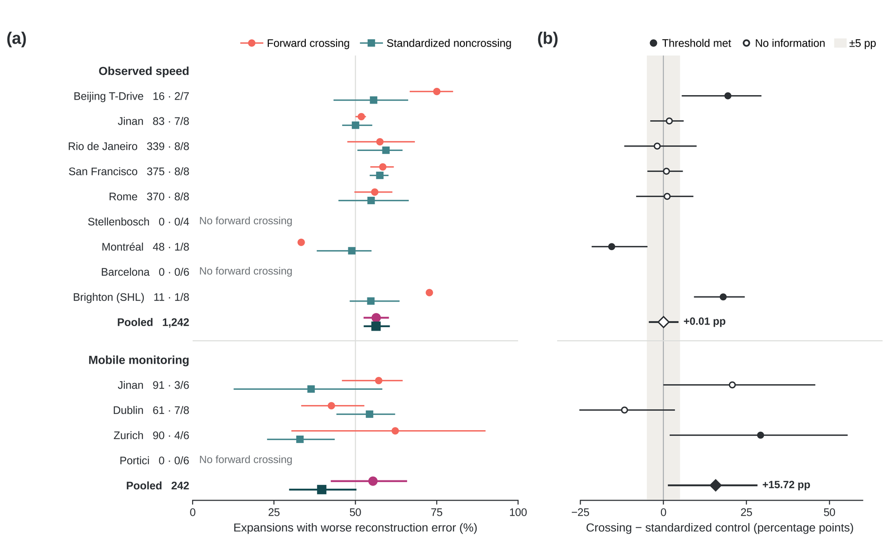
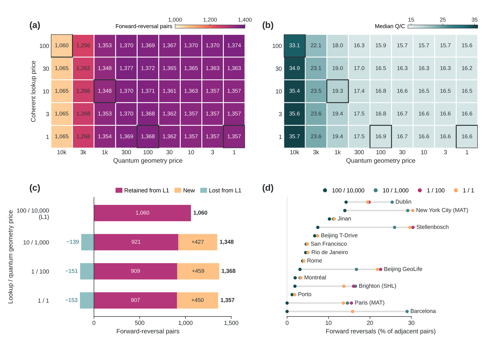
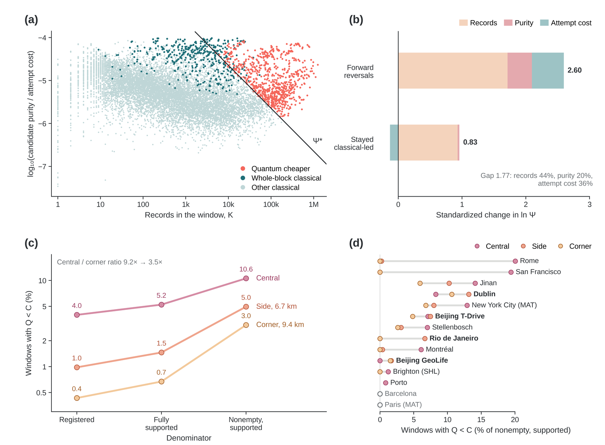
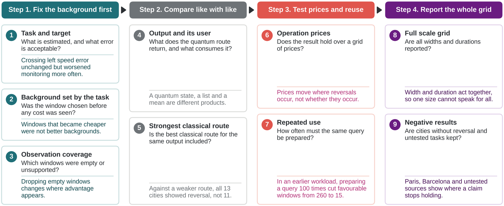
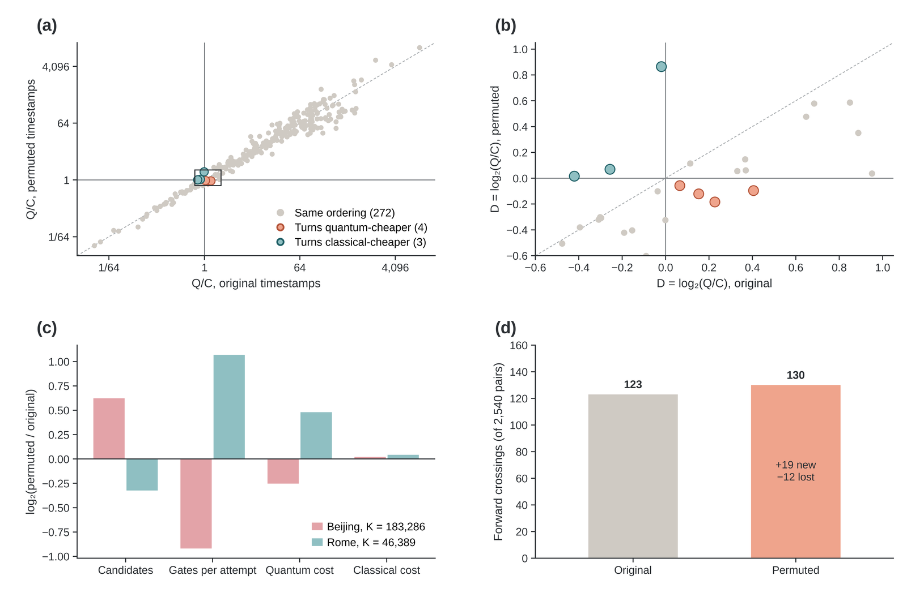
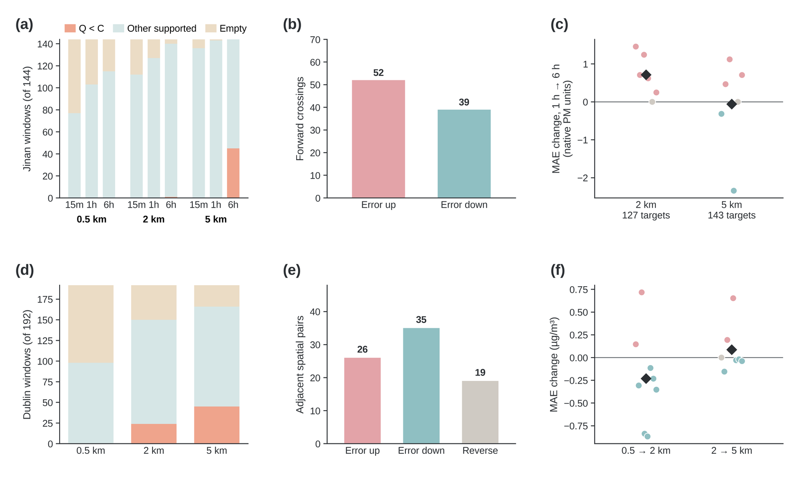

# scale-reversal

Computations for one manuscript on scale reversal in quantum range queries
for urban mobility data. This package does not reimplement the query engine.
Window evaluation, access-route accounting, pricing and repricing all call
[qrq](https://pypi.org/project/qrq/) 0.2.0, a general library for quantum
range queries over spatio-temporal records. qrq contains no study-specific
code; everything particular to this study lives here.

## What is here

* The registered window grid: six widths, four durations, nine anchors and
  three time centres, and the adjacent-scale pairs built from it.
* Readers for the sealed evidence archive and checks that reproduce the
  published counts: 13,370 nonempty windows, 742 with `Q < C`, 17,592
  adjacent pairs, 1,060 forward and 11 reverse reversals.
* The 45-point price sweep and its reporting points.
* The amplitude-amplification sensitivity.
* The reconstruction-task comparison and its date-block bootstrap.
* Figure scripts that redraw the manuscript figures from the source tables
  (`figures/README.md`).

## Install

```bash
pip install qrq==0.2.0
pip install ".[test]"
```

Figure rendering needs the extra `figures` dependencies (`pip install ".[figures]"`).

## Reproduce the published numbers

Derived tables, per-tree cost ledgers and figure source tables are in
`evidence/`. Raw trajectory and monitoring records are not included.
With the archive root in `SR_EVIDENCE`:

```bash
SR_EVIDENCE=evidence python -m scale_reversal all --check
```

Exit status 0 means the cohort, the price sweep, the
amplitude-amplification sensitivity and the task comparison all match the
published numbers. `pytest` without `SR_EVIDENCE` runs the synthetic tests
and skips the sealed ones. Details, artefact overrides and numerical notes
are in `docs/reproduction.md`; the public sources are listed in
`docs/data_access.md`.

## Figures

Previews of the manuscript figures. The scripts in `figures/` redraw Figures
1-6 and Supplementary Figures S1-S3 from the source tables. Figure 7 is the
evaluation checklist.



















```bash
SR_FIGURE_DATA=evidence/figure_source SR_EVIDENCE=evidence python figures/make_all.py
```

See `figures/README.md`. The Rome trajectory layer of Figure 1 needs the
taxi records from their provider and is not redistributed.

## License

MIT, see `LICENSE`. Citation metadata is in `CITATION.cff`.
